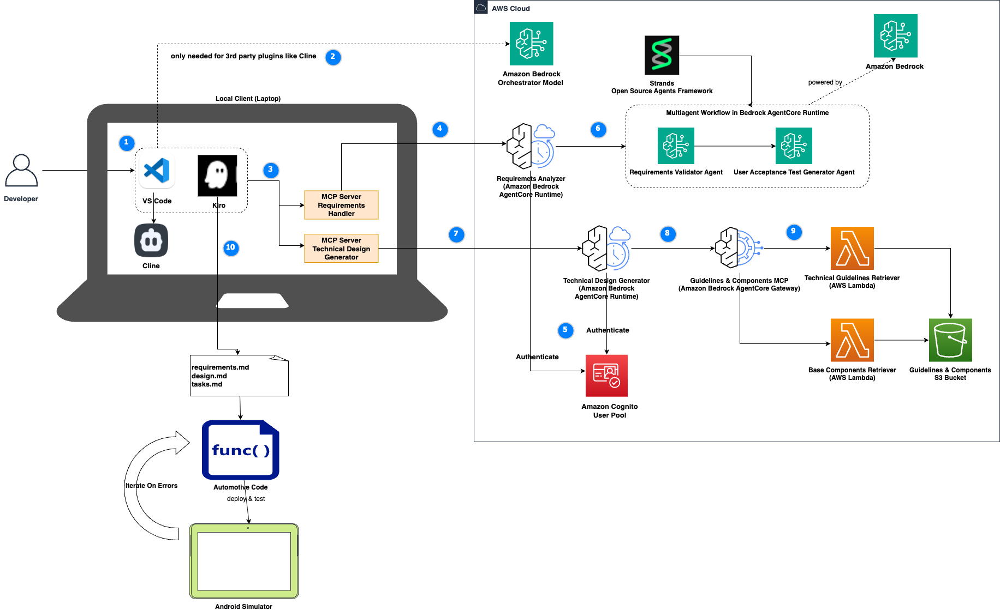

# Agentic Automotive V-Cycle Assistant

In this demo we are showcasing an a agentic V-Cycle assistant based on Kiro and Bedrock AgentCore, where an Android Weather-App is implemented based on the requirements.

Demo Flow:

1. Kiro makes use of Strands impl. hosted on Bedrock AgentCore (exposed as MCP endpoints to Kiro) to handle requirements analysis, user acceptance test generation and technical design generation
2. Kiro IDE used to to create detailed specifications using spec driven development. At the end Kiro comes up with decomposed tasks based on the documents from step 1.
3. Kiro-CLI is used to iterate over coding, testing and deployment via Android emulators.

An example of a navigation flow with Kiro following the numbering in the diagram might look like this:

1. Developer prompts "analyze requirements of weather-app".
2. Using the underlying orchestrator model, Kiro understands that the task can be handled using the requirements analyzer MCP. Kiro searches the workspace for business requirements specification of the weather-app.
3. Kiro calls the "requirements analyzer" tool to validate the requirements and generate user acceptance tests if applicable.
4. MCP Server forwards the request to AgentCore Runtime.
5. AgentCore Runtime uses Amazon Cognito to authenticate the user.
6. AgentCore Runtime utilizes the multi-agent workflow implemented in Strands to generates a requirements analysis report and user acceptance tests. The analysis report and user acceptance test document are saved in the workspace. Note that the model for each of these steps can be chosen according to the specific task and does not have to be the same.
7. After the developer reviews/adjusts the documents, the user may want to generate technical designs. Upon prompting "generate technical design for weather-app", this time Kiro calls the technical design generator which delegates to respective AgentCore Runtime endpoint.
8. After authentication via Cognito, technical design generator agent calls Guidelines MCP tool hosted in AgentCore Gateway.
9. Agent retrieves the technical guidelines located in the S3 bucket and generates the technical design and sends it back to Kiro. Kiro saves the document in the local workspace.
10. Now developer can make use of Kiro to initiate a spec driven development based on requirements and tech. design. This results in respective specs documents. After the review of the developer, Kiro goes forward with code generation and validates the implementation using the integrated Android Simulator. In case of problems the agent is able to iterate and fix the code iteratively until the application is fully developed.

## Components

### 1. Requirements Analyzer Agent  
Multi-agent system for business and technical requirements analysis with user acceptance test generation.

**Key Features:**
- Analyzes business requirements documents for consistency and completeness
- Checks for conflicting requirements and missing sections
- Generates comprehensive user acceptance test specifications
- Supports IEEE 830 standards and automotive requirements workflows

**Location:** `backend/requirements-agent/`  
**MCP Server:** `mcp-servers/automotive-requirements-mcp/`  
**Documentation:** See [Requirements Analyzer README](backend/requirements-agent/README.md) for detailed setup and usage instructions.

### 2. Software Design Agent
Multi-agent system that transforms validated requirements into comprehensive technical design documents for automotive software development.

**Key Features:**
- Generates technical design documents from validated requirements
- Validates design completeness with severity-based analysis (LOW, MEDIUM, HIGH)
- Conditionally validates design quality when completeness criteria are met
- Ensures alignment with automotive safety standards (ISO 26262, UNECE WP.29)
- Includes architecture diagrams, component specifications, interface definitions, and data models

**Location:** `backend/design-agent/`  
**MCP Server:** `mcp-servers/automotive-design-mcp/`  
**Documentation:** See [Software Design Agent README](backend/design-agent/README.md) for detailed setup and usage instructions.

### 3. C Code Analyzer Agent
Multi-agent system for automotive C code analysis with custom automotive coding standards compliance checking and unit test generation.

**Key Features:**
- Analyzes C code for custom automotive coding standards violations (AUTO-SAFE-001, AUTO-MEM-001, AUTO-FUNC-001, AUTO-STYLE-001)
- Categorizes violations by severity (LOW, MEDIUM, HIGH)
- Conditionally generates comprehensive unit tests for compliant code
- Includes edge cases, boundary conditions, and automotive testing standards

**Location:** `backend/c-code-analyzer-agent/`  
**MCP Server:** `mcp-servers/automotive-coding-mcp/`  
**Documentation:** See [C Code Analyzer README](backend/c-code-analyzer-agent/README.md) for detailed setup and usage instructions.

## IDE Integration Support
The project support Kiro and Cline based integrations. Kiro with Android setup is already set as the default and the files are available directly under ./kiro. Additional configuration files are available under 
- **Location**: `ide-support/`
- See respective README files for detailed instructions. 

## Getting Started

### Prerequisites
- Python 3.13+ (Recommended: virtual environment at workspace level created and top level requirements installed)
- AWS credentials configured for a US based region
- Amazon Bedrock AgentCore SDK access

### C Code Analyzer Agent

For detailed setup instructions see the [C Code Analyzer README](backend/c-code-analyzer-agent/README.md).

### Requirements Analyzer Agent

For detailed setup instructions, see the [Requirements Analyzer README](backend/requirements-agent/README.md).

### Software Design Agent

For detailed setup instructions see the [Software Design Agent README](backend/design-agent/README.md).

## Available MCP Tools

Once your IDE MCP configuration is completed according to the `backend/xx-agent/README.md` files above, your IDE will have access to the following MCP tools.

### Automotive Requirements MCP Server  
- **Location**: `mcp-servers/automotive-requirements-mcp/`
- **Function**: `mcp_automotive_requirements_automotive_requirements_analyzer`
- **Purpose**: Analyze requirements documents and generate user acceptance tests
- **Usage**: Integrated into IDEs via MCP protocol

### Automotive Design MCP Server
- **Location**: `mcp-servers/automotive-design-mcp/`
- **Function**: `mcp_automotive_design_automotive_design_generator`
- **Purpose**: Generate technical design documents from requirements documents 
- **Usage**: Integrated into IDEs via MCP protocol

### Automotive Coding MCP Server
- **Location**: `mcp-servers/automotive-coding-mcp/`
- **Function**: `mcp_automotive_coding_analyze_c_code`
- **Purpose**: Analyze C code for automotive standards compliance and generate unit tests
- **Usage**: Integrated into IDEs via MCP protocol

## Security & Deployment

- **Authentication**: Amazon Cognito with JWT token validation
- **Permissions**: IAM role-based access control
- **Runtime**: Secure deployment on Amazon Bedrock AgentCore Runtime
- **Cleanup**: Optional cleanup procedures for AgentCore instances, ECR repositories, and IAM roles

## Benefits of MCP Integration
- **Real-time Analysis**: Analyze code and requirements directly in your IDE
- **Automated Testing**: Generate unit tests and UATs on-demand
- **Standards Compliance**: Continuous automotive coding standards checking
- **Workflow Integration**: Seamless integration with development workflows
