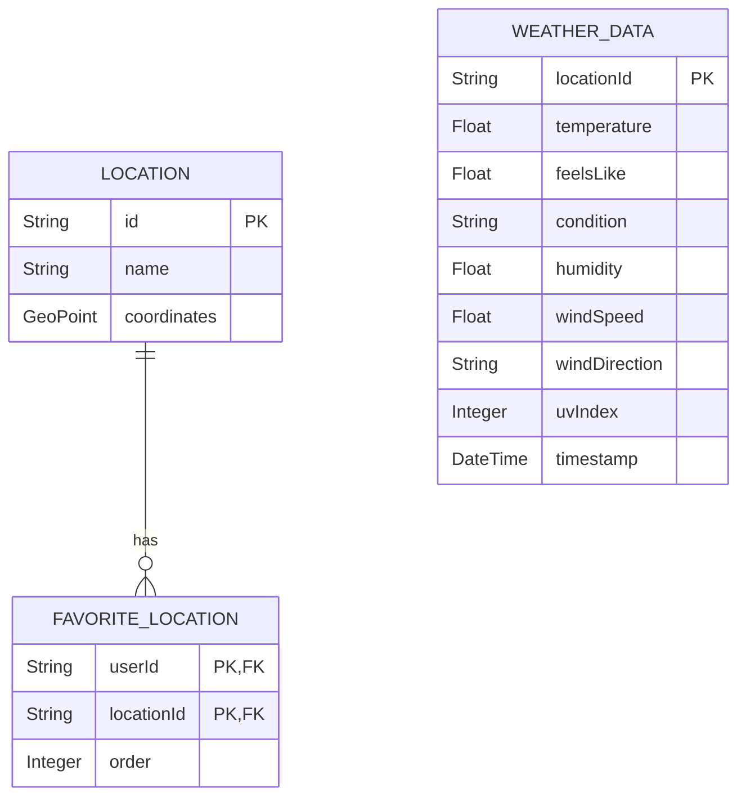

## Technical Design Document: Weather Application for Vehicle Infotainment System

### **Version 1.0.0**  
*Prepared: October 27, 2025*  
*Approved By: Brunilda Caushi*  

---

## **1. Executive Summary**

### **1.1 Purpose**
This Technical Design Document (TDD) outlines the detailed architecture, component specifications, interface definitions, data models, safety considerations, implementation guidance, error handling, and testing strategy for the **Weather Application** integrated into the vehicle's infotainment system. The application provides drivers with real-time, contextual weather information while ensuring minimal driver distraction and compliance with automotive safety standards.

### **1.2 Key Requirements**
- **Safety Classification**: ASIL-B for weather alert delivery; ASIL-A for non-critical display features  
- **Performance Targets**:  
  - App Launch: < 3 seconds  
  - API Response: < 500ms  
  - Memory Usage: < 50MB  
- **Platform Constraints**: Android Auto-compatible, Kotlin-based development, integration with in-vehicle middleware services  

### **1.3 Project Constraints**
- **Team Size**: 2 engineers with Android Auto and Kotlin experience  
- **Timeline**: 6 months (ready for SOP)  
- **Budget**: $15,000  
- **Testing Resources**: 1 vehicle test unit, 1 test environment  

---

## **2. Architecture Overview**

### **2.1 High-Level System Architecture**

```plaintext
+---------------------+     +---------------------+     +---------------------+
|   Driver Interface  |<--->| Infotainment System |<--->| External Weather API |
| (UI, Voice Commands)|     | (Android Auto App)  |     | (Current Conditions, |
+---------------------+     +---------------------+     |  Forecasts, Alerts) |
                                                    |
                                                    v
                                         +---------------------+
                                         | Vehicle Middleware  |
                                         | (Location, Connectivity)|
                                         +---------------------+
                                                    |
                                                    v
                                         +---------------------+
                                         | Vehicle Core Systems|
                                         | (ADAS, Battery Mgmt) |
                                         +---------------------+
```

### **2.2 Component Layers**

| Layer               | Components                                                                 | Description                                                                 |
|---------------------|----------------------------------------------------------------------------|-----------------------------------------------------------------------------|
| **UI Layer**        | Status Bar Display, Forecast Screen, Radar Map, Voice Command UI           | Renders weather data, handles user interactions                            |
| **Business Logic**  | Weather Service, Voice Command Processor, Alert Manager, Data Cache Manager | Core logic for data fetching, voice command parsing, alert handling        |
| **Data Layer**      | API Client, Local Database, Sensor Data Adapter                            | Handles data retrieval, storage, and integration with vehicle sensors      |
| **Integration Layer**| Middleware Adapter, OTA Update Manager, Security Module                    | Interfaces with vehicle systems and external services                      |

---

## **3. Component Specifications**

### **3.1 UI Layer**

| Component ID | Purpose                                    | Responsibilities                                                                 | Dependencies                          | Performance Targets                |
|--------------|--------------------------------------------|---------------------------------------------------------------------------------|---------------------------------------|---------------------------------------|
| UI-001       | Status Bar Display                         | Show ambient temperature/weather icon persistently                              | Business Logic Layer                  | Render within 1s of data update    |
| UI-002       | Forecast Screen                            | Display detailed forecasts, manage favorite locations                           | Business Logic Layer                  | Load within 2s of navigation       |
| UI-003       | Radar Map                                  | Render real-time weather radar maps                                            | Data Layer                            | Smooth zoom/pinch gestures          |
| UI-004       | Voice Command UI                           | Capture and display voice command feedback                                      | Business Logic Layer                  | Response within 3s                 |

### **3.2 Business Logic Layer**

| Component ID | Purpose                                    | Responsibilities                                                                 | Dependencies                          | Performance Targets                |
|--------------|--------------------------------------------|---------------------------------------------------------------------------------|---------------------------------------|---------------------------------------|
| BL-001       | Weather Service                            | Fetch current conditions, forecasts, alerts from external API                    | Data Layer                            | API calls < 500ms                  |
| BL-002       | Voice Command Processor                    | Parse voice commands, determine intent                                           | UI Layer, Data Layer                  | Command parsing < 2s               |
| BL-003       | Alert Manager                              | Monitor and trigger severe weather alerts                                        | Data Layer, UI Layer                  | Alert delivery < 60s               |
| BL-004       | Data Cache Manager                         | Store and retrieve cached weather data                                           | Data Layer                            | Cache retrieval < 100ms            |

### **3.3 Data Layer**

| Component ID | Purpose                                    | Responsibilities                                                                 | Dependencies                          | Performance Targets                |
|--------------|--------------------------------------------|---------------------------------------------------------------------------------|---------------------------------------|---------------------------------------|
| DL-001       | API Client                                 | Handle secure communication with external weather API                           | Integration Layer                     | TLS handshake < 1s                 |
| DL-002       | Local Database                             | Store favorite locations, cached weather data, user settings                    | Business Logic Layer                  | Query response < 100ms             |
| DL-003       | Sensor Data Adapter                        | Interface with vehicle sensors (e.g., windshield wipers, outside temp sensors)   | Integration Layer                     | Data sync < 200ms                  |

### **3.4 Integration Layer**

| Component ID | Purpose                                    | Responsibilities                                                                 | Dependencies                          | Performance Targets                |
|--------------|--------------------------------------------|---------------------------------------------------------------------------------|---------------------------------------|---------------------------------------|
| IL-001       | Middleware Adapter                         | Communicate with in-vehicle location and connectivity services                  | Vehicle Middleware                    | Location updates < 200ms           |
| IL-002       | OTA Update Manager                         | Handle secure over-the-air updates                                              | Security Module                       | Update install < 5min              |
| IL-003       | Security Module                            | Manage encryption, authentication, and secure storage                            | All Layers                            | Key validation < 500ms              |

---

## **4. Interface Definitions**

### **4.1 APIs and Protocols**

| Interface         | Protocol/Standard              | Description                                                                 | Data Format       |
|-------------------|-------------------------------|-----------------------------------------------------------------------------|------------------|
| **Weather API**   | RESTful API, HTTPS (TLS 1.3)  | Fetch current conditions, forecasts, alerts                                 | JSON             |
| **Vehicle API**   | Android for Cars API          | Access location, connectivity, and sensor data                               | Protobuf         |
| **Voice Assistant**| Google Assistant API         | Process voice commands                                                      | JSON             |
| **Radar API**     | Map Tile Service (HTTPS)      | Retrieve radar map tiles                                                     | PNG/JPEG         |
| **OTA Service**   | FOTA Protocol (HTTPS)         | Deliver and install application updates                                      | ZIP/PB           |

### **4.2 Data Contracts**

#### **Current Weather Response**
```json
{
  "location": "New York",
  "temperature": 22.5,
  "feelsLike": 24.1,
  "condition": "Partly Cloudy",
  "humidity": 65,
  "windSpeed": 12.3,
  "windDirection": "NW",
  "uvIndex": 5,
  "timestamp": "2025-10-27T14:30:00Z"
}
```

#### **Severe Weather Alert**
```json
{
  "alertId": "TORNADO-20251027-1430",
  "type": "Tornado Warning",
  "severity": "High",
  "description": "Tornado warning for NYC area. Seek shelter immediately.",
  "geofence": { "type": "Polygon", "coordinates": [...] },
  "timestamp": "2025-10-27T14:30:00Z"
}
```

---

## **5. Data Models**

### **5.1 Entity Relationships**



### **5.2 Schema Constraints**
- **Temperature**: Range -50°C to 60°C  
- **Humidity**: Range 0% to 100%  
- **Wind Speed**: Range 0 m/s to 100 m/s  
- **Location Coordinates**: Valid GeoJSON format  

---

## **6. Safety Considerations**

### **6.1 ISO 26262 Compliance**

| Feature                      | ASIL Level | Rationale                                                                 |
|------------------------------|------------|---------------------------------------------------------------------------|
| Ambient Temperature Display  | ASIL-A     | Non-safety-critical, passive display                                      |
| Voice Command Processing     | ASIL-A     | Minimal driver distraction                                                |
| Severe Weather Alerts        | ASIL-B     | Active safety intervention, potential to prevent accidents                |
| Background Data Streaming    | ASIL-D     | Critical for ADAS and battery management systems                          |

### **6.2 Failure Modes and Mitigation**

| Failure Mode                  | Impact Level | Mitigation Strategy                                                  |
|------------------------------|--------------|----------------------------------------------------------------------|
| API Unavailability           | Medium       | Fallback to cached data, display "Service Unavailable" message       |
| Voice Command Misinterpretation | Low        | Confirm intent via UI prompt, limit commands while driving            |
| Severe Alert Miss            | High         | Redundant alert channels (audio + visual), periodic alert refresh     |
| Data Corruption              | Medium       | CRC checks on API responses, secure storage encryption               |

### **6.3 Driver Distraction Measures**
- **Voice Command Priority**: Only allow voice commands when vehicle is stationary or at low speed (< 30 km/h)  
- **UI Timeout**: Auto-dismiss full-screen interfaces after 10 seconds of inactivity while driving  
- **Visual Alerts**: Non-dismissible pop-ups for severe alerts, with auto-dismiss after acknowledgment  

---

## **7. Implementation Guidance**

### **7.1 Development Phases**

| Phase        | Duration | Key Activities                                                 | Deliverables                     |
|--------------|----------|----------------------------------------------------------------|----------------------------------|
| **Phase 1**  | Month 1  | Requirements analysis, architecture design, setup development environment | Architecture docs, project scaffold |
| **Phase 2**  | Months 2-3 | UI development, API integration, voice command implementation | UI mockups, API wrappers         |
| **Phase 3**  | Months 4-5 | Integration testing, performance optimization, security hardening | Test reports, optimized binaries  |
| **Phase 4**  | Month 6  | OTA update implementation, user acceptance testing, release preparation | OTA package, release notes        |

### **7.2 Key Technologies**
- **Language**: Kotlin  
- **Frameworks**: Android for Cars App Library, Coroutines, Retrofit  
- **Libraries**: Kotlin Serialization, Room Database, Glide for image loading  
- **Tools**: Android Studio, Gradle, Jenkins (CI/CD), Firebase Crashlytics  

### **7.3 Project Structure**
```
app/
├── src/
│   ├── main/
│   │   ├── java/com/amazon/vehicle/weather/
│   │   │   ├── ui/              // UI components
│   │   │   ├── service/         // Business logic
│   │   │   ├── data/            // Data layer
│   │   │   ├── integration/     // Vehicle middleware
│   │   │   └── util/            // Utilities
│   │   └── res/                 // Resources (layouts, drawables)
├── test/
│   └── unit/                    // Unit tests
└── androidTest/
    └── instrumentation/         // Instrumentation tests
```

---

## **8. Error Handling**

### **8.1 Error Scenarios and Recovery**

| Scenario                          | Error Code | Recovery Strategy                                               |
|-----------------------------------|------------|-----------------------------------------------------------------|
| Network Failure                    | ERR-NET-001 | Retry with exponential backoff, use cached data                  |
| API Rate Limit Exceeded            | ERR-API-002 | Queue requests, notify user when available                      |
| Voice Command Timeout              | ERR-VOICE-003 | Prompt user to repeat command, disable voice while driving       |
| Severe Alert Delivery Failure      | ERR-ALERT-004 | Retry push notification, fallback to periodic refresh            |
| Data Corruption                    | ERR-DATA-005 | Rollback to last valid cache, log and report                      |

### **8.2 Logging Strategy**
- **Log Level**: DEBUG in development, INFO in production  
- **Retention**: 30 days on device, 90 days in cloud  
- **Sensitive Data**: Never log user IDs, locations, or API keys  

---

## **9. Testing Strategy**

### **9.1 Test Approach**

| Test Type            | Tools/Methods                          | Coverage Target |
|----------------------|----------------------------------------|-----------------|
| **Unit Tests**       | JUnit, Mockito                         | 80%             |
| **UI Tests**         | Espresso, AndroidX Test                | 70%             |
| **Integration Tests**| MockWebServer, WireMock                | 90%             |
| **Performance Tests**| JMeter, Android Profiler               | Meet all targets|
| **Safety Tests**     | ISO 26262 compliance checklist         | 100%            |
| **Security Tests**   | OWASP ZAP, static analysis (Detekt)    | Pass all checks |

### **9.2 Coverage Plan**

| Area                     | Test Coverage | Verification Method                     |
|--------------------------|---------------|-----------------------------------------|
| Functional Requirements  | 95%           | Test cases mapped to SRS IDs            |
| Performance Requirements | 100%          | Automated benchmarks against targets     |
| Safety Requirements      | 100%          | ISO 26262 compliance audit              |
| Security Requirements    | 100%          | Penetration testing, code review         |
| Usability                | 90%           | User acceptance testing with drivers     |

--- 

## **10. Conclusion**

This Technical Design Document provides a comprehensive blueprint for developing a safe, efficient, and user-friendly weather application integrated into the vehicle's infotainment system. By adhering to ISO 26262 standards, leveraging Kotlin and Android for Cars frameworks, and implementing robust error handling and testing strategies, the application will enhance driver safety, engagement, and vehicle performance while meeting all business and technical requirements.
